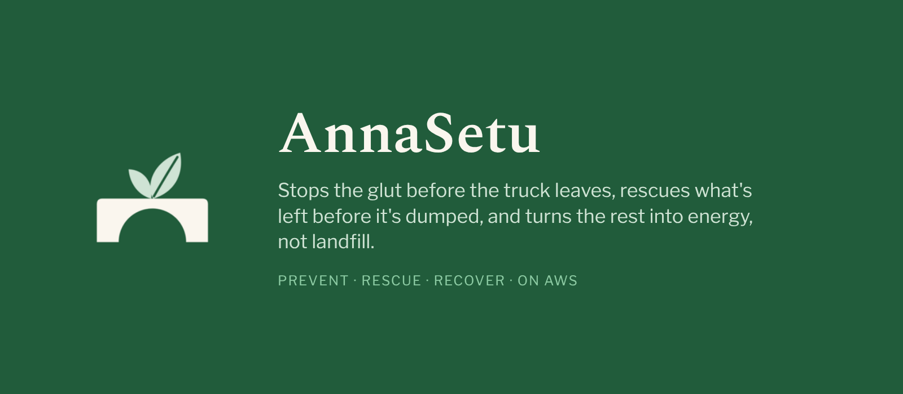
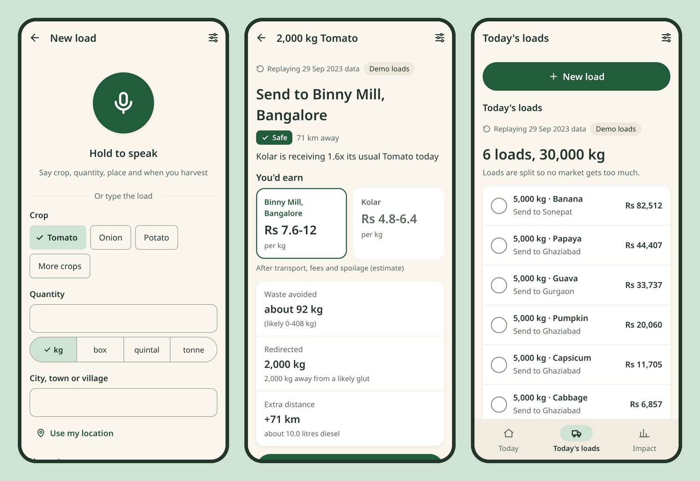
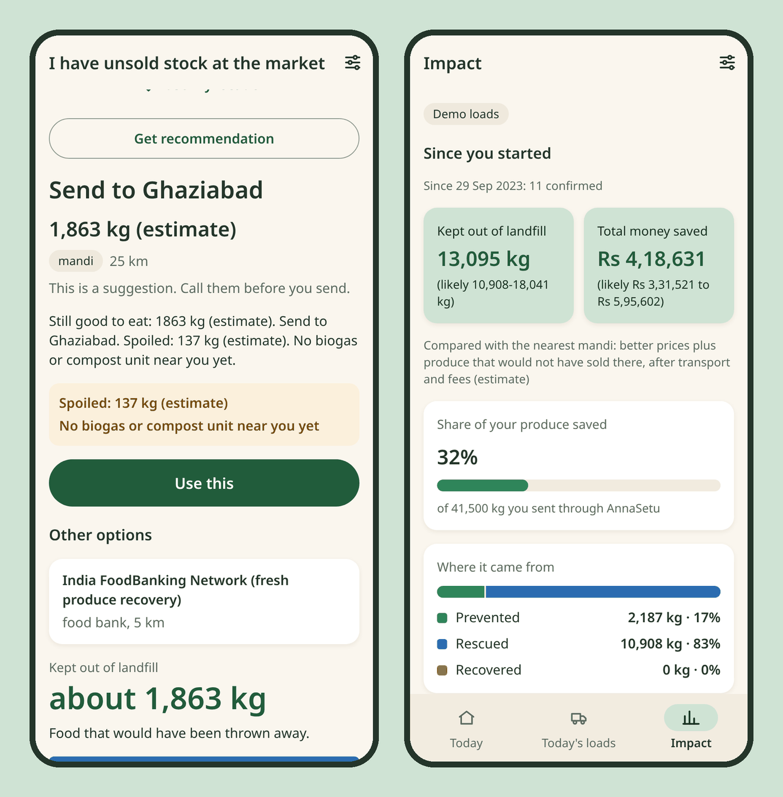
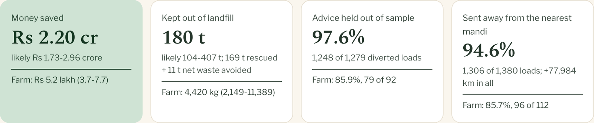
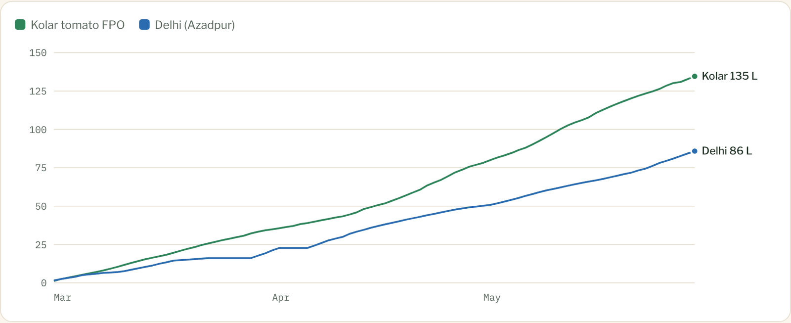
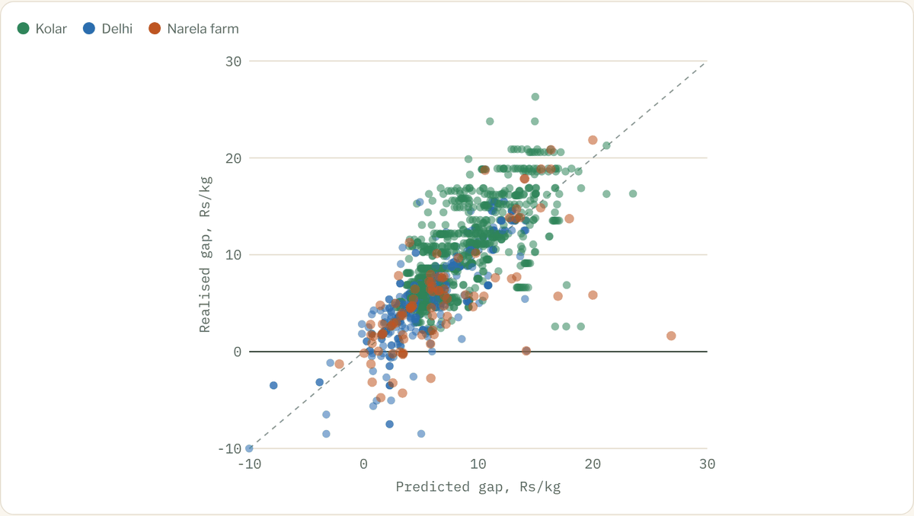
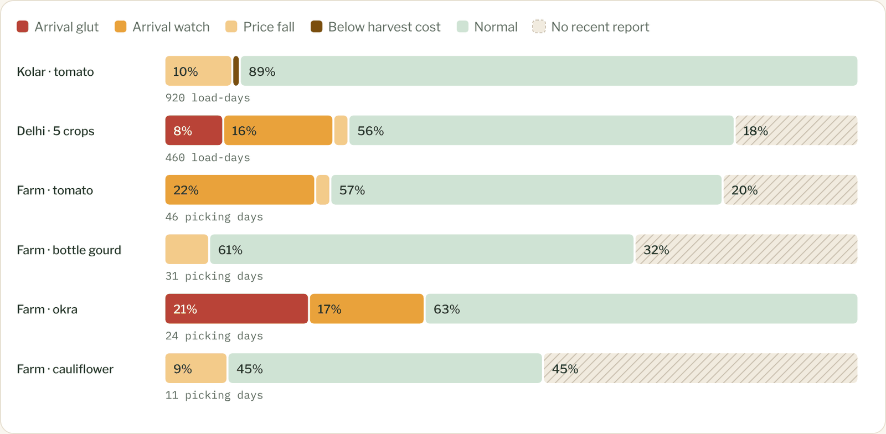
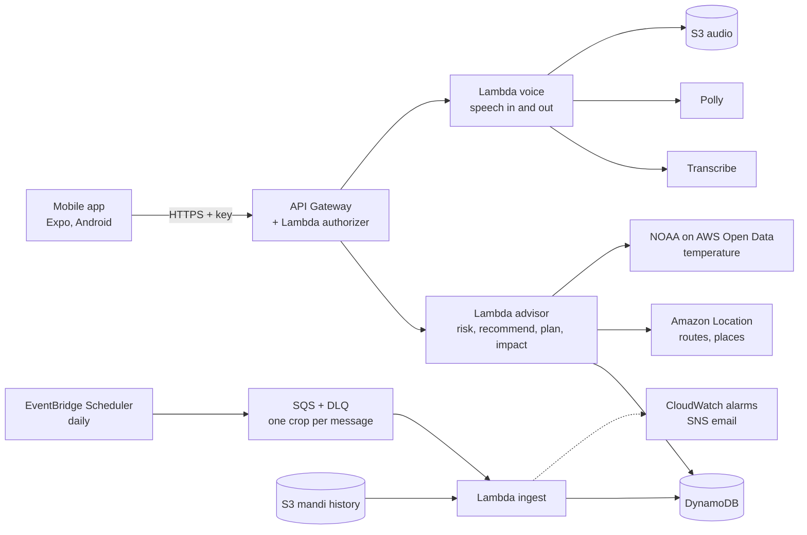

<p align="center"></p>

<p align="center">
<b><a href="https://github.com/Lakshya1901/AnnaSetu_AWS/releases/download/v1.0/annasetu.apk">Download the Android APK</a></b> ·
<b>Demo video: TBD</b> ·
<b><a href="docs/AnnaSetu_2026_Replay.pdf">2026 stat report and case study</a></b> ·
<b><a href="TECHNICAL.md">Technical details</a></b>
</p>

<p align="center"><b>An algorithmic perishable food dispatch and market coordination system that anticipates local gluts and intelligently allocates produce across markets and second-life outlets to prevent edible food from becoming waste.</b></p>

<p align="center">
<b>Prevent:</b> ranks every reachable market by what the farmer actually keeps after freight, fees and spoilage, and spreads the day's loads so no market is pushed into a glut.<br>
<b>Rescue:</b> sends a city trader's unsold stock to another mandi that still pays, a processor or a food bank before it is dumped.<br>
<b>Recover:</b> routes what can't be eaten to animal feed, biogas or compost, never to landfill.
</p>

<p align="center">WeMakeDevs x AWS Environmental Hacks · Track: Waste and Energy · Serverless on AWS (ap-south-1), built and deployed with the AWS SAM CLI</p>

---

## Good food, thrown away for the wrong reason

India loses **7.36 Mt of fruit and 11.97 Mt of vegetables a year** ([Rajya Sabha, Feb 2025](https://rsdebate.nic.in/bitstream/123456789/758453/1/PQ_267_07022025_U572_p312_p312.pdf)). Most of it is lost near the farm, and most of it because the **price collapses before the food spoils**.

| | |
| --- | --- |
| **Kolar, 2025** | Harvesting and moving a 15 kg box of tomatoes cost about Rs 70; it sold for as little as Rs 30, so crops were left in the field ([Outlook Business](https://www.outlookbusiness.com/explainers/farmers-in-india-struggle-with-falling-tomato-prices-whats-behind-the-price-drop)) |
| **Same food, 5x the value** | Tomatoes dumped in Udumalaipettai sold for about 5x more across the Kerala border ([Onmanorama](https://www.onmanorama.com/news/kerala/2025/09/04/tomato-farmers-discarding-produce-roadside.html)) |
| **Farm vs market** | Tomato loss is 8.37% on the farm against 3.25% at the market ([FreshPlaza](https://www.freshplaza.com/asia/article/9756104/india-reports-high-guava-and-tomato-losses/)) |

The truck is sent on yesterday's price and a trader's word, and a whole belt ships to the same mandi on the same day. The prices and arrivals that could prevent it are public; nobody turns them into a decision for one truck. At the city mandi, what is left unsold at day end goes to the dump.

## One router, three entry points

| **Prevent** | **Rescue** | **Recover** |
| --- | --- | --- |
| A farmer collective (FPO) says, by voice or form, what load it has. AnnaSetu ranks every reachable market by **what the farmer actually keeps** after freight, fees, commission and trip spoilage, and **spreads the day's loads** so it never pushes a market into a glut itself. | A trader at a city mandi (headline: **Azadpur, Delhi**) logs unsold stock. The engine estimates the spoiled share; the edible part goes to **another mandi that still pays, a processor or a food bank**. | What can't be eaten goes to **animal feed, biogas or compost**, never a dump. Every outlet is a real organisation, marked "Not yet partnered". |

<p align="center"></p>

<p align="center"><sub>Real screens, live API, Demo mode replaying the documented Kolar tomato glut of 29 Sep 2023. Earnings first, then waste avoided; redirected kg is never added to it.</sub></p>

<p align="center"></p>

<p align="center"><sub>Unsold stock at Azadpur and the Impact tab: kept out of landfill = prevented + rescued + recovered.</sub></p>

**Built for the people who decide:** English plus India's 20 most spoken languages, voice input in 12 of them, spoken replies in Hindi and English, big touch targets, risk always shown as colour + word + icon. AnnaSetu advises; people decide, and every override is logged.

## Results: three months of 2026, routed by the deployed engine

We ran the advisor's own `/plan` and `/recommend` code on **every day from 1 March to 31 May 2026** on real mandi prices, arrivals, weather and routes. Each day: ten tomato loads from a Kolar FPO, five 5-tonne loads from Azadpur and one 2-tonne unsold lot at Azadpur. A second run follows one simulated 8-acre farm near Narela, Delhi.

<p align="center"></p>

<p align="center"></p>

<p align="center"><b>Rs 2.20 crore</b> more for farmers (likely 1.73-2.96) than selling at the nearest mandi, after every cost.</p>

<p align="center"></p>

<p align="center"><b>Did it really pay?</b> We checked each diverted load against the next real prices at both markets: the advice held on <b>1,248 of 1,279</b>.</p>

<p align="center"></p>

- **169 t of 184 t** of unsold stock at Azadpur rescued to mandis within 100 km; the rest is the estimated spoiled share.
- **Waste avoided comes from glut days:** net +11 t (range -65 to +238 t). Delhi gained 18 t, mostly banana on 39 Azadpur glut days; Kolar lost 6 t, because with no glut this spring a longer trip only adds spoilage. We report that, not just the wins.
- **Weak spot: cauliflower.** The advice held on 14 of 35 Delhi loads and 4 of 10 farm loads.
- **1,562 requests across both runs, 0 errors, deterministic**, and 120 backend tests pass.

All loads and the farm are simulated; prices, arrivals, weather and routes are real; money and waste are model estimates. Full charts in the [2026 report](docs/AnnaSetu_2026_Replay.pdf).

## How it decides

No black box. Plain Python, every parameter in `config/` with its source and status.

| Step | What it computes |
| --- | --- |
| 1. Glut risk | Arrivals against the same weeks in earlier years, plus the 3-day price change: safe, watch or glut |
| 2. Price on arrival | Today's price, lowered for the kilos AnnaSetu has already sent there |
| 3. Trip spoilage | Shelf life at the trip's temperature, hours since harvest, drive time and wait |
| 4. Net value per kg | Price after spoilage, freight, market fee, commission and handling |
| 5. Allocation | Largest load first; skip any market the load would tip into a glut |
| 6. Impact | Waste avoided vs the nearest mandi (a range), redirected kg kept separate |

The backtest showed arrivals do not warn days ahead of a crash, so AnnaSetu makes **no early-warning claim**: it avoids sending a load into a glut today.

## Built on AWS



| AWS service | What it does in AnnaSetu |
| --- | --- |
| **API Gateway** (HTTP API) + Lambda authorizer | The only entry point; checks the app's key, 10 rps throttle |
| **Lambda** `advisor` | The decision engine: radar, recommendations, plans, impact |
| **Lambda** `voice` | Audio upload, Transcribe job, spoken-load parse, Polly reply |
| **Lambda** `ingest` + **EventBridge Scheduler** + **SQS** (with dead-letter queue) | Daily, one crop per message: reads mandi history from S3, recomputes market risk |
| **DynamoDB** | Market risk, outlets, and every plan, explanation and override |
| **S3** | Per-crop mandi history; audio clips deleted after 1 day |
| **Amazon Location Service** | Any typed place in India; truck routes and drive times |
| **AWS Registry of Open Data** | NOAA GHCN-Daily station temperature for the spoilage estimate |
| **Transcribe** / **Polly** | Speech in 12 Indian languages / spoken replies in Hindi and Indian English |
| **Systems Manager Parameter Store** | API keys as SecureString |
| **CloudWatch** + **SNS** | Logs; alarms on ingest errors and the dead-letter queue, by email |
| **AWS SAM CLI**, **CloudFormation**, **IAM** | Built, run locally and deployed with SAM; one least-privilege role per function |
| **Bedrock** (Converse API) | Wired to parse speech and explain advice; not enabled in our account, so templates run |

The app talks only to API Gateway and holds no AWS credentials. Details: [TECHNICAL.md, Architecture](TECHNICAL.md#8-architecture-and-aws-usage).

## What is real and what is simulated

| Real | Simulated or estimated |
| --- | --- |
| Mandi prices and arrivals (AGMARKNET via India Data Portal; live Agmarknet prices) | The loads, the unsold lots and the Narela farm |
| Documented gluts (Kolar 2023 and 2025) | Spoilage (modelled from temperature and hours) |
| Weather (NASA POWER, NOAA GHCN, Open-Meteo) and Amazon Location routes | Waste avoided and money saved (ranges) |
| Processors, food banks, biogas and compost units (real organisations, not contacted) | Freight, commission, handling and dump share (desk-research placeholders until FPO interviews) |

The app says it on screen: "Replaying \<date\> data", "Demo loads" and "All numbers are estimates".

## Try it

- **Android:** install [`annasetu.apk`](https://github.com/Lakshya1901/AnnaSetu_AWS/releases/download/v1.0/annasetu.apk) from the [v1.0 release](https://github.com/Lakshya1901/AnnaSetu_AWS/releases/tag/v1.0) (allow installs from unknown sources). Settings has **Live** (today's mandi prices) and **Demo** (fills itself with a full day at Azadpur on the replayed glut day).
- **iOS:** [Simulator build](https://github.com/Lakshya1901/AnnaSetu_AWS/releases/download/v1.0/AnnaSetu.iOS.tar.gz) for a Mac with Xcode (unzip, drag `AnnaSetu.app` onto a running Simulator), or open the project in Expo Go on an iPhone. Real-device builds need a paid Apple Developer account.
- **Backend:** `python -m pytest backend/tests -q`, or run the advisor locally on the snapshot with `python -m backend.handlers.local_server --port 8787`.
- **Deploy:** `cd infra && sam build && sam deploy --guided` ([infra/README.md](infra/README.md)).

## Repository layout

```
README.md                  this page
TECHNICAL.md               full reference: sources, assumptions, backtest, model, architecture, limits
PRODUCT.md                 users, tone and design principles for the app
analysis/
  backtest.py              deterministic backtest CLI -> results JSON + charts
  second_replay.py         arrival-driven glut search (D14)
  simulate_2026.py         2026 replay (D38); simulate_farm_2026.py: Narela farm; sim_summary.py: report figures
  backtest.ipynb           viewer only
  out/                     backtest charts (PNG); results JSON is git-ignored and kept in S3
backend/
  core/                    decision engine: risk, pricing, spoilage, netvalue, allocate, impact, recommend (no AWS)
  adapters/                all external calls: agmarknet, ceda, weather, location, bedrock, speech, store
  handlers/                thin Lambda wrappers: advisor, voice, ingest, authorizer, local_server
  tests/                   120 pytest tests and API fixtures, stubbed AWS clients
config/
  model.json assumptions.json markets.json outlets.json commodities.json
  crops/                   50 routable fruit and vegetable profiles (D33)
  copy/                    English + 20 Indian languages (D27)
data/
  snapshot/                India Data Portal tomato and onion files + manifest, NASA POWER and NOAA GHCN weather
  routes_cache.json        Amazon Location routes (filled by scripts/cache_routes.py)
  places_cache.json        Amazon Location place lookups for offline runs (D31)
infra/                     SAM template, Makefile, deploy guide
scripts/                   build_idp.py build_idp_config.py build_agmarknet_ids.py build_osm_outlets.py build_snapshot.py geocode_markets.py cache_routes.py seed.py
app/                       Expo app: screens, components, typed API client, i18n
docs/                      2026 stat report and case study (PDF)
```

## Limits

- Live mode has prices but no arrivals (Agmarknet puts them behind a captcha), so load splitting runs in Demo only.
- Costs and the dump share are placeholders until FPO interviews; every figure built on them is a range.
- Outlets are real but not yet partnered; Delhi has no biogas or compost unit with a source yet.
- Indian-language text is machine-drafted and needs native review; Polly speaks only Hindi and English.

The full list, every source and assumption and the backtest: **[TECHNICAL.md](TECHNICAL.md)**.

---

<sub>Built with [Claude Code](https://claude.com/claude-code) (Anthropic's AI coding tool), disclosed as the event rules require. Data: India Data Portal AGMARKNET files (ODC-By), Agmarknet, NASA POWER, NOAA GHCN-Daily, OpenStreetMap (ODbL).</sub>
