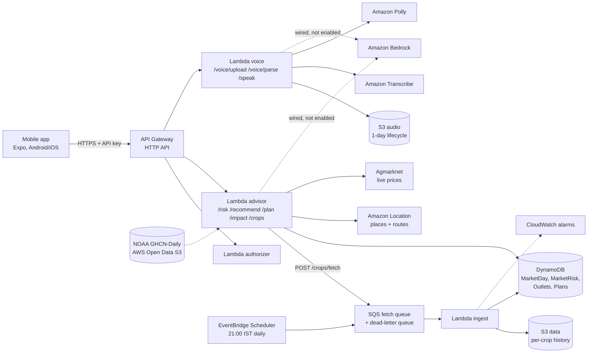

# AnnaSetu: routing India's surplus produce before it becomes city garbage

Every day, a city's mandis turn good food into garbage. AnnaSetu is our attempt to stop the glut before the truck leaves, rescue what is left before it is dumped, and send the rest to feed, biogas or compost instead of landfill. We built it in four days for the WeMakeDevs x AWS Environmental Hacks (Waste and Energy track). This post covers the problem, the model, the AWS architecture, and what a three-month replay on real 2026 mandi data did and did not show.

- Repo: https://github.com/Lakshya1901/aws
- Android APK: https://expo.dev/artifacts/eas/zimvjrUv9exYufPVm1UZrpx6QHH-wNO9-IqEBOfqDn8.apk

## The problem: food that loses its value before it spoils

In early 2025, tomato growers in Kolar, Karnataka, faced a simple sum. Harvesting and transporting a 15 kg box cost about Rs 70; the box sold for as little as Rs 30. Crops were left in the field ([Outlook Business](https://www.outlookbusiness.com/explainers/farmers-in-india-struggle-with-falling-tomato-prices-whats-behind-the-price-drop)). Tomatoes from Udumalaipettai in Tamil Nadu were dumped by the roadside while the same box sold for about 5x more across the Kerala border ([Onmanorama](https://www.onmanorama.com/news/kerala/2025/09/04/tomato-farmers-discarding-produce-roadside.html)).

Two years earlier, in September 2023, Kolar had a different kind of crash. Officials attributed it to "the arrival of a large quantity of tomatoes": Kolar APMC received 4.21 lakh quintals that month against 2.31 lakh quintals a year earlier ([Deccan Herald](https://www.deccanherald.com/india/karnataka/rs-200-to-rs-10-tomato-farmers-hopes-crash-2700660)).

The national figures point the same way:

- Fruit loss runs at 6.02-15.05% and vegetable loss at 4.87-11.61%: 7.36 Mt and 11.97 Mt a year ([Rajya Sabha, Feb 2025](https://rsdebate.nic.in/bitstream/123456789/758453/1/PQ_267_07022025_U572_p312_p312.pdf)).
- Tomato loss is 8.37% on the farm against 3.25% at the market; guava is 11.59% against 3.46% ([FreshPlaza](https://www.freshplaza.com/asia/article/9756104/india-reports-high-guava-and-tomato-losses/)).
- The cold chain serves about 10% of fresh produce, and over 75% of cold storage capacity was built for potatoes ([NCCD, Sept 2025](https://nccd.gov.in/uploads/ET_in_cold_chain_sector_in_India_v8_3bfe3b8148.pdf)).

So most loss happens at or near the farm gate, and mostly because the market value collapses before the food itself goes bad. The decision that sets the loss (harvest now? which mandi?) is made with yesterday's local price and a trader's word. The data that could change it, AGMARKNET mandi prices and arrivals, is public. Nobody turns it into a per-load decision before loading. And when a whole belt harvests together and ships to the nearest mandi, arrivals spike and the price crashes. A price predictor alone does not fix that herding; an allocator can.

For scale: 1% of the 19.3 Mt of fruit and vegetables lost each year is about 193,000 tonnes of food. We target perishables only, and we make no claim of a percentage reduction until one is measured.

## One router, three entry points

AnnaSetu asks one question: where should this surplus go, and what will it earn after costs? It has three ways in, all on the same engine.

- **Prevent.** An FPO (farmer producer organisation) dispatch manager enters a load by voice or form. The app ranks every reachable outlet by net value per kg and spreads the day's loads so they do not all crash the same market.
- **Rescue.** A trader at a city mandi such as Azadpur in Delhi logs unsold end-of-day stock. The engine proposes an edible/spoiled split, which the trader can edit. It then sends the edible part to another mandi within 100 km that still pays, or to a processor or food bank.
- **Recover.** What cannot be eaten goes to animal feed, then biogas, then compost. Never a dump.

The Impact Ledger reports kg kept out of landfill (Prevented + Rescued + Recovered) as an estimate range. "Redirected" (kg sent somewhere other than the nearest mandi) sits on its own line and is never added to waste avoided. Biogas energy shows "not yet estimated" until we have a sourced yield.

## The model in plain words

The engine is pure Python with no machine learning. Every parameter lives in versioned JSON config with a status: sourced, assumption or placeholder.

1. **Glut ratio.** For each market and crop, R is the 7-day average of arrivals divided by the usual arrivals for that time of year in prior years. Below 1.3 is safe. Watch starts at 1.3, or at a 15% price drop in 3 days. Glut is 2.0 or more, or above 1.5 with a 25% drop. Our backtest found that arrivals do not lead price by enough to warn ahead, so the app runs in same-day mode: it tells you about today's glut, not a coming one.
2. **Price on arrival.** The expected price falls as more produce arrives, including the loads AnnaSetu itself has already sent there. Ranges come from each market's day-to-day price swings.
3. **Spoilage from temperature and travel time.** There are no sensors. Shelf life shrinks with temperature through a Q10 factor, and the share lost grows with hours since harvest, drive time from Amazon Location routes, and a 6-hour wait at the mandi.
4. **Net value per kg.** Price after spoilage, minus freight, market fee, commission and handling (fees follow the destination state).
5. **Anti-herding allocation.** Loads are placed largest first, each at its best-paying market, unless that load would push the market's projected ratio into glut. Then the next best gets it. A market whose risk cannot be checked, or whose data is over 7 days old, is listed but never chosen. If no fresh market pays, the load walks down the food waste hierarchy.

Waste avoided compares expected loss (trip spoilage plus an unsold or dumped share) at the nearest mandi against the advised outlet. The dump share is a placeholder table until FPO interviews calibrate it.

## Architecture on AWS

Everything runs in ap-south-1 and is defined in one AWS SAM template.

**Data sources.**

- Market-level history comes from the India Data Portal's AGMARKNET bulk files: daily arrivals and prices for every commodity, January 2021 to May 2026. It is split into one file per commodity in S3.
- Every night EventBridge Scheduler fans out the 50 preloaded fruits and vegetables over SQS, one ingest run per crop. Each run recomputes MarketRisk in DynamoDB. Any of the roughly 400 commodities can be loaded on request.
- Live mode fetches each nearby market's last-week prices from Agmarknet and caches them for the day. Arrivals there sit behind a captcha, so live risk is price-only and live mode does not split loads.
- Temperature comes from NASA POWER hourly snapshots for the replays, NOAA GHCN-Daily station data read straight from the AWS Registry of Open Data bucket, and an Open-Meteo forecast for today.

**Voice.** The app uploads audio to S3 through a presigned URL. Amazon Transcribe handles 12 Indian languages, and Amazon Polly replies in Hindi and Indian English (no other Indian voices exist). The app text itself covers English plus 20 Indian languages.

**Bedrock.** Amazon Bedrock is wired through the Converse API for exactly two jobs: parsing a spoken load into fields, and writing a two-sentence explanation from computed facts. Any number not in its input triggers a template. It is not enabled in our account: our request for Anthropic model access was refused, and the model ID is a deploy parameter. Today, a rule-based parser and per-language templates do both jobs. Bedrock never calculates or picks an outlet.

**AWS SAM CLI.** `infra/template.yaml` declares the Lambdas, the HTTP API, the four tables, both buckets, the schedule, the queues, the alarms, the Location resources and one least-privilege IAM role per function. Our loop was `sam build`, then `sam local start-api` to run the handlers locally against the snapshot, then `sam deploy --guided` to ap-south-1. The app holds no AWS credentials; it only talks to API Gateway.

## What the 2026 replay showed

We pointed the deployed advisor code at every day from 1 March to 31 May 2026, the last month in the data. Each day it routed ten simulated tomato loads from a Kolar FPO, five 5-tonne loads from Azadpur, and one 2-tonne unsold tomato lot at Azadpur. All figures below are model estimates on real prices, arrivals, weather and routes.

- 1,380 loads, 0 failed requests, deterministic output. 94.6% were sent away from the nearest mandi.
- Money saved: Rs 2.20 crore (range 1.73-2.96).
- Out-of-sample check: we compared the next real price report at both markets within 7 days, after freight. The advice held on 1,248 of 1,279 diverted loads.
- Rescue: 169 t of 184 t of unsold stock found a mandi within 100 km.
- Waste avoided: net +11 t, with a range of -65 to +238 t. Delhi contributed +18 t, mostly banana on 39 Azadpur arrival-glut days. Kolar came out at -6 t: with no glut there this spring, the longer trips added spoilage.

Two weak spots, stated plainly. First, waste avoided is small, or negative, on days without a glut; the gain on those days is price, not food. Second, Delhi cauliflower: the advice held on only 14 of 35 checkable loads, because prices at the advised markets moved more than their history suggested. Kolar's edge was real (903 of 903 held), but it sent every load to Bengaluru. Our anti-herding cap needs arrivals data to check that, and live mode does not have it.

The Narela case study ran one simulated 8-acre farm near Narela, north-west Delhi (tomato, bottle gourd, okra, cauliflower), on the same 2026 data. The nearest reporting mandi was Azadpur. Results:

- 112 loads (127 t), 0 errors, 85.7% sent elsewhere.
- Money saved Rs 5.2 lakh (3.7-7.7).
- Waste avoided +844 kg net.
- 3,576 kg of 3,900 kg of unsold stock rescued.
- The advice held on 79 of 92 diverted loads. Cauliflower held on only 4 of 10, and okra and bottle gourd gained less than predicted.

## What is real and what is simulated

| Real | Simulated or assumed |
| --- | --- |
| Mandi prices and arrivals (replayed, or today's Agmarknet prices) | Every load, unsold lot and the Narela farm |
| Documented glut events | Freight, commission, handling, diesel: desk-research placeholders |
| Weather and Amazon Location routes | Dump share by glut level: a placeholder heuristic |
| Processors, food banks, biogas and compost units (real organisations) | Spoilage: estimated, not measured |

None of the outlets has been contacted; the app labels them "Not yet partnered". Delhi has one sourced Second Life outlet, India FoodBanking Network. We found no operating biogas or compost unit near Delhi with a source, so Delhi Recover honestly says "No biogas or compost unit near you yet".

## What we would do next

- Interview FPOs to replace the placeholder freight, commission, handling and dump-share values.
- Partner with real outlets, starting with a food bank and a biogas unit near Azadpur.
- Get native-speaker review of every string. All languages except English are pending, and most were machine-drafted.
- Enable Bedrock once model access is granted. It needs no code change.
- Find an arrivals feed for live mode so the load split works outside replays.

Built with Claude Code.
